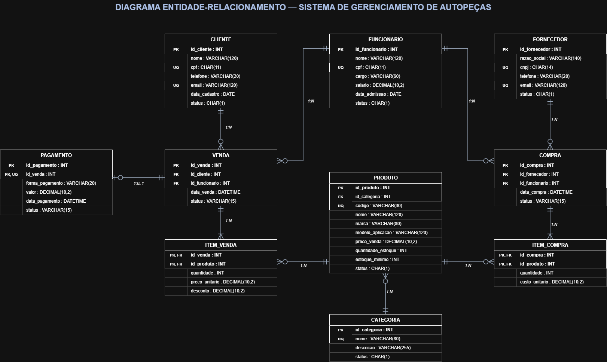

# Sistema de Gerenciamento de Autopeças

## 1. Sobre o projeto

Este projeto foi desenvolvido como trabalho final da disciplina de Banco de Dados. A ideia foi criar um banco de dados para uma loja de autopeças, permitindo organizar informações de clientes, funcionários, fornecedores, produtos, vendas, compras e pagamentos.

O banco foi desenvolvido utilizando MySQL, com tabelas relacionadas entre si para facilitar o armazenamento e a consulta das informações.

## 2. Tecnologias utilizadas

- MySQL: criação e gerenciamento do banco de dados.
- MySQL Workbench: ferramenta utilizada para executar os comandos SQL.
- SQL: linguagem utilizada para criar as tabelas, inserir os dados e realizar as consultas.
- Draw.io: ferramenta utilizada para criar o diagrama DER.
- GitHub: utilizado para armazenar e organizar os arquivos do projeto.

## 3. Estrutura do banco de dados

O banco de dados recebeu o nome de `sistema_autopecas` e foi organizado em 10 tabelas:

| Tabela | Descrição |
|---|---|
| cliente | Armazena os dados dos clientes. |
| funcionario | Guarda as informações dos funcionários. |
| fornecedor | Armazena os dados dos fornecedores. |
| categoria | Organiza os produtos por categoria. |
| produto | Contém os dados dos produtos e do estoque. |
| venda | Registra as vendas realizadas. |
| item_venda | Armazena os produtos de cada venda. |
| compra | Registra as compras feitas com fornecedores. |
| item_compra | Armazena os produtos de cada compra. |
| pagamento | Guarda as informações dos pagamentos das vendas. |

## 4. Relacionamentos

As tabelas foram relacionadas utilizando chaves primárias (PK) e chaves estrangeiras (FK).

Também foram utilizados relacionamentos de muitos para muitos (N:N), por meio das tabelas intermediárias:

- `item_venda`: relaciona vendas e produtos.
- `item_compra`: relaciona compras e produtos.

A tabela `pagamento` possui relacionamento de um para um (1:1) com a tabela `venda`.

## 5. Diagrama DER

O diagrama abaixo apresenta as tabelas do banco de dados e seus respectivos relacionamentos.

## 6. Recursos utilizados na estrutura

Durante a criação das tabelas, foram utilizados alguns recursos do SQL para manter a organização e evitar dados incorretos:

- **PRIMARY KEY:** identifica cada registro.
- **FOREIGN KEY:** estabelece os relacionamentos entre as tabelas.
- **NOT NULL:** impede que determinados campos fiquem vazios.
- **UNIQUE:** evita valores duplicados em campos específicos.
- **CHECK:** define condições que os dados precisam atender.
- **DEFAULT:** define valores automáticos para alguns campos.

## 7. Inserção dos dados

Depois de criar as tabelas, foram inseridos os registros para permitir os testes do banco de dados.

O projeto possui pelo menos 15 registros em cada tabela, possibilitando realizar consultas e verificar os relacionamentos entre as informações.

## 8. Consultas SQL

Foram desenvolvidas e executadas 12 consultas para testar o funcionamento do banco de dados.

As consultas foram divididas da seguinte forma:

- **Consultas simples:** para visualizar e filtrar informações das tabelas.
- **Consultas com INNER JOIN:** para buscar informações relacionadas em duas ou mais tabelas.
- **Consultas complementares:** utilizando recursos como LEFT JOIN, subconsulta, COUNT, SUM, AVG, MAX, MIN, GROUP BY e HAVING.

As consultas permitem, por exemplo, visualizar vendas com os dados dos clientes, consultar produtos, verificar compras e analisar informações de vendas.

## 9. Como executar o projeto

Para utilizar o banco de dados, é necessário ter o MySQL instalado.

1. Abrir o MySQL Workbench.
2. Conectar ao servidor MySQL.
3. Abrir o arquivo SQL do projeto.
4. Executar os comandos para criar o banco de dados, as tabelas e inserir os registros.
5. Abrir o arquivo de consultas para executar e testar os comandos SQL.

## 10. Considerações finais

Com o desenvolvimento deste trabalho, foi possível colocar em prática os conteúdos estudados na disciplina de Banco de Dados, principalmente a criação de tabelas, definição de chaves, relacionamentos, inserção de registros e consultas SQL.

O resultado foi um banco de dados organizado para uma loja de autopeças, com informações relacionadas e consultas que permitem visualizar diferentes dados do sistema.
